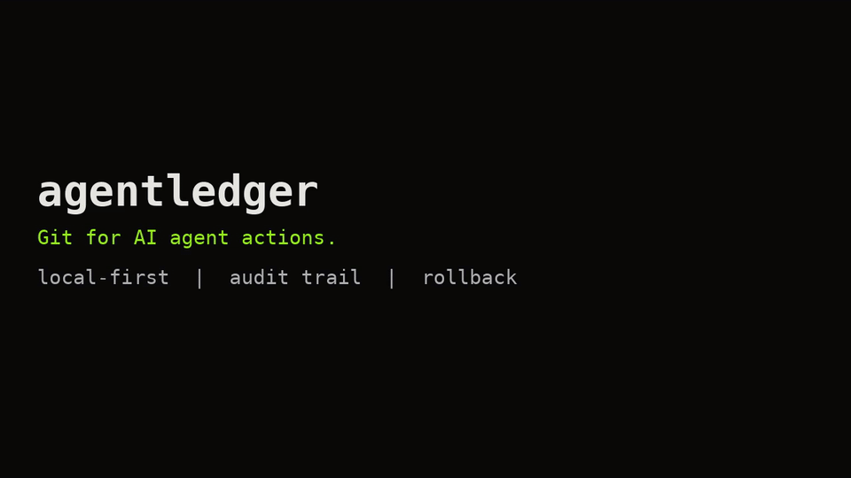

# agentledger

Git for AI agent actions.

Your AI agent changed 37 files. Do you remember why?

    agentledger run -- claude
    agentledger undo last

## Demo

[Full video (demo.mp4)](demo.mp4)

## Install

1. Download a prebuilt binary from the latest release at
   https://github.com/Rafax01x/agentledger/releases/latest,
   choose the binary for your operating system and
   architecture, make it executable, and put it on your PATH.
2. Or install with Go:
   `go install github.com/Rafax01x/agentledger/cmd/agentledger@latest`
3. Or build from source (requires a Go toolchain for go 1.26
   as declared in `go.mod`, and a `git` binary):

```sh
git clone https://github.com/Rafax01x/agentledger.git
cd agentledger
go build -o agentledger ./cmd/agentledger
```

## Quickstart

In an existing Git repository, with at least one commit:

```sh
agentledger init
agentledger run -- sh -c "echo 'changed' >> a.txt && echo 'new' > c.txt"
agentledger log
agentledger show last --diff
agentledger diff last --stat
agentledger undo last
agentledger ui
```

Open http://127.0.0.1:4848 after `agentledger ui` for the local
inspector: searchable session timeline (sidebar filter, `j`/`k`
navigation, `/` or Cmd+K to focus it), collapsible diff viewer
with per-file Revert buttons, redacted output with a
stdout/stderr filter, and a Revert Session button (or `u`) with
a confirmation modal. The undo endpoint also accepts
`{"files": [...]}` for selective file reverts.

## Configuration

An optional `.agentledger.yaml` (or `.agentledger.json`) in the
repository root tunes recording. YAML is a small subset: top-level
keys, string lists, booleans, and name/regex maps.

```yaml
ignore_paths:
  - "*.log"
  - "vendor/"
redact_patterns:
  - name: INTERNAL_TOKEN
    regex: "tok-[A-Za-z0-9]{16,}"
redact_env_files: true
```

- `ignore_paths`: glob patterns excluded from recorded diffs (and
  therefore from undo). `*.log` matches at any depth; a trailing
  `/` ignores a whole directory.
- `redact_patterns`: custom regex rules, masked as
  `<REDACTED:NAME>` in stored output and diffs.
- `redact_env_files` (default `true`): values longer than 6
  characters from a local `.env` file are masked in stored output
  and diffs. The `.env` file itself is never stored.

## Pruning old sessions

```sh
agentledger clean --older-than 30d --keep-last 10 --dry-run
agentledger clean --older-than 30d --keep-last 10
```

`clean` deletes sessions older than the age (the newest
`--keep-last` are always kept), removes their snapshot refs, and
reports reclaimed disk space after a database VACUUM. `--dry-run`
lists what would be deleted without deleting anything.

The last step restores the working tree to its state before
the wrapped command ran.

## How it works

agentledger wraps a CLI agent command, snapshots the Git working tree before the command runs, lets the agent run with its output streaming live to your terminal, snapshots the tree again when the command finishes, records the session, its file changes, and its output in a local SQLite database, and lets you inspect or undo that session later with a single command.

```
user -> agentledger run -> snapshot -> agent -> snapshot -> SQLite -> undo
```

## Safety

- never touches your branch, commits, or index
- never sends data to any network
- never runs without an explicit `run` command
- `undo` refuses to run on dirty working tree unless --force
- `undo --file path` (repeatable, `-f` shorthand) reverts only
  listed files; `undo --dry-run` prints what would change
- `ui` binds loopback only (127.0.0.1) and shares undo's rules

In practice, undo's dirty check compares each file against
the session's start and end snapshots, so a file already
restored to its start state does not block undo, and a
file changed after the session ended does.

## Limitations

See [docs/limitations.md](docs/limitations.md) for the honest
list of what v0.2 does not do.

## Roadmap

Shipped in v0.2 from the v0.1 candidate list: project config file
(YAML/JSON instead of TOML), session pruning (`clean`), and
expanded redaction (custom patterns + `.env` values). Still open
from [docs/limitations.md](docs/limitations.md):

- `--agent` flag for `run` to override the agent name
  (currently the command basename)
- `log` filtering: by agent, by date range, by exit code,
  full-text search over commands and output
- `export --output <file>` instead of stdout-only export
- A pre-undo snapshot, so post-session edits overwritten
  with `--force` are preserved by agentledger
- `doctor --fix` to create a missing `.agentledger/`
  automatically
- Redaction for additional secret shapes (`github_pat_`,
  npm, PyPI, GCP keys, URLs with embedded passwords),
  and a `--no-redact` escape hatch for local debugging
- Undo for file-mode-only changes, and undo of an entire
  directory tree as one unit
- A `run --dry-run` that snapshots without running, for
  testing snapshot behaviour
- Shell completions and a man page

## Contributing

Contributions are welcome. See
[CONTRIBUTING.md](CONTRIBUTING.md) for how to build, test,
and submit a pull request.
